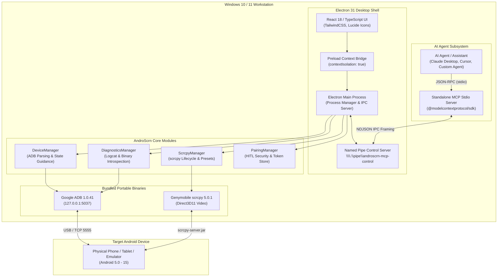

# AndroScrn — Android Device Workbench for Windows

<div align="center">

# 📱 AndroScrn
### Open-Source Android Device Workbench, ADB GUI & Supervised MCP Server for Windows

[](LICENSE)
[](https://github.com/sukeshperiyasamy/Androscrn)
[](https://microsoft.com/windows)
[](https://github.com/Genymobile/scrcpy)
[](https://developer.android.com/tools/adb)
[](https://modelcontextprotocol.io)
[](tests/)
[](https://github.com/sukeshperiyasamy/Androscrn/actions/workflows/ci.yml)

**"One workbench for Android debugging, device inspection and supervised AI automation."**

</div>

---

**AndroScrn** brings **Android device management on Windows**, ultra-low latency **Android screen mirroring**, raw binary **Android screenshots and logcat** analysis, hardware diagnostics, and supervised **Model Context Protocol server for Android** operations into a single, cohesive desktop workbench.

Built with **Electron, React and TypeScript**, AndroScrn consolidates fragmented command-line workflows into a hardware-aware workspace. It bundles Google ADB 1.0.41 and Genymobile scrcpy 5.0.1 to provide responsive device control, while exposing a strictly governed **MCP tools for AI agents** interface for **AI-assisted Android testing** and **Android QA automation**.

> **Project Status (v1.0.0-alpha.1):**
> AndroScrn is an active, open-source developer tool. In accordance with [ADR-001](docs/adr/001-architecture-reconciliation-and-mcp.md), the desktop application is currently implemented as an **Electron 31 + Node.js 20 LTS + React 18** workbench for immediate Windows deployment, featuring an out-of-process standalone MCP stdio server communicating over a local Windows Named Pipe (`\\.\pipe\androscrn-mcp-control`). A future migration to Tauri 2 + Rust is planned once toolchain dependencies are stabilized.

---

## 📑 Table of Contents

- [Why AndroScrn?](#why-androscrn)
- [Features & Implementation Status](#features--implementation-status)
- [Workbench Overview & UI Preview](#workbench-overview--ui-preview)
- [System Architecture](#system-architecture)
- [Requirements & Compatibility](#requirements--compatibility)
- [Portable CLI & No-Installer Distribution](#portable-cli--no-installer-distribution)
- [Quick Start](#quick-start)
- [Model Context Protocol (MCP) Integration](#model-context-protocol-mcp-integration)
- [Testing & Verification](#testing--verification)
- [Security & Privacy Governance](#security--privacy-governance)
- [Project Roadmap](#project-roadmap)
- [Troubleshooting & FAQ](#troubleshooting--faq)
- [Contributing & License](#contributing--license)

---

<a id="why-androscrn"></a>
## 💡 Why AndroScrn?

Developers and QA teams debugging physical Android devices on Windows frequently juggle disconnected utilities:
* Running terminal commands (`adb devices`, `adb logcat`, `adb shell`) in separate command prompts.
* Launching independent `scrcpy` scripts that lose process management when USB connections drop.
* Manually pulling screenshots and videos with `adb pull` or converting lossy text streams.
* Integrating AI agents (like Claude Desktop, Cursor, or autonomous test runners) that need device access but lack security controls, bounds validation, or Human-in-the-Loop oversight.

**AndroScrn bridges these gaps into a single ADB GUI for Windows:**
1. **Unified Device Workbench:** Auto-detects USB and Wi-Fi devices, monitors battery levels, provides instant state guidance for unauthorized/offline hardware, and manages screen mirroring sessions with zero configuration overhead.
2. **Deterministic Process Isolation:** Enforces target serial scoping (`-s <serial>`) across all child processes to eliminate collisions when multiple devices or emulators are connected.
3. **Supervised AI Device Control:** Rather than providing external AI models with unrestricted shell access, AndroScrn implements an isolated MCP stdio server with a strict **Human-in-the-Loop (HITL)** permission gatekeeper, display bounds validation, input sanitization, and a real-time desktop action audit log.

*Note: AndroScrn does not replace scrcpy. It integrates scrcpy's proven Direct3D11 hardware decoding engine directly into a structured productivity workbench.*

---

<a id="features--implementation-status"></a>
## ⚡ Features & Implementation Status

In compliance with rigorous engineering standards, all capabilities are classified by verified implementation status:

### 1. Implemented & Verified Capabilities

| Capability | Engine / Subsystem | Verification Level | Description |
| :--- | :--- | :--- | :--- |
| **Android Device Discovery & State Guidance** | Bundled ADB 1.0.41 parser | Automated tests & Physical hardware | Real-time USB/Wi-Fi enumeration, battery percentage tracking, and actionable guidance for unauthorized or offline devices. |
| **Multi-Device Serial Scoping** | `-s <serial>` argument isolation | Automated tests | Guarantees all mirroring, capture, and input commands target only the selected device. |
| **Low-Latency Screen Mirroring** | Bundled scrcpy 5.0.1 process engine | Automated tests & Physical hardware | Launches scrcpy's native hardware-accelerated Direct3D11 streaming window alongside the workbench (scrcpy handles GPU video rendering; AndroScrn manages process lifecycle and quality presets). |
| **Raw Binary Screenshot Capture** | `adb exec-out screencap -p` | Automated tests & Physical hardware | Streams raw framebuffer bytes directly into PNG buffers; validates 8-byte PNG signature (`89 50 4E 47 0D 0A 1A 0A`). |
| **Captures Gallery & Folder Explorer** | Filesystem scanner (`Captures/`) | Automated tests | Real-time scanner for `.png` and `.mp4` recordings with one-click native Windows shell viewing. |
| **System Diagnostics & Credential Redaction** | Host engine introspection | Automated tests & Physical hardware | Inspects local ADB and scrcpy binaries; redacts emails, bearer tokens, and pairing PINs via automated regex masking. |
| **Dual-Stream Logcat Viewer** | Device logcat + Application log | Automated tests & Physical hardware | Color-coded threadtime log streaming with severity level filtering (Verbose to Fatal) and text search. |
| **Wireless TCP/IP & Pairing UI** | ConnectionManager (TCP/IP port 5555) | Automated tests | Validates network ports and Android 11+ pairing inputs; USB-to-wireless handoff and auto-reconnect are hardware- and network-dependent. |
| **Model Context Protocol (MCP) Server** | `@modelcontextprotocol/sdk` | Automated tests | Decoupled stdio server exposing 12 specialized tools across 4 permission tiers. |
| **Human-in-the-Loop (HITL) Gatekeeper** | Windows Named Pipe IPC | Automated tests | Out-of-band 6-digit PIN and 1-click desktop approval cards; pairing PIN is never leaked to AI agents. |
| **Tier 3 Controlled Device Input** | Safe `adb shell input` vectors | Automated tests | `tap`, `swipe`, `keyevent`, and `input_text` with screen bounds validation, `%s` space encoding, and shell metacharacter defense. |
| **Live AI Action Audit Log** | Electron IPC event dispatcher | Automated tests & UI verification | Real-time UI feed auditing external AI actions (`PENDING`, `SUCCESS`, `FAILED`, `REJECTED`) without logging sensitive text or session tokens. |
| **Emergency Revocation Kill Switch** | In-memory token store | Automated tests & UI verification | Instantaneous one-click global session token invalidation across all running MCP instances. |
| **Camera Studio MVP (Phase 5)** | Bundled scrcpy 5.0.1 camera mode | Automated tests & Physical hardware | Dedicated Camera Studio UI, physical camera sensor introspection (`0:back`, `1:front`, ultrawide, macro), Direct3D11 streaming, digital zoom controls (`1.0x - 10.0x`), live torch toggle, continuous PC-side MP4 recording (`--record=...`), and capability detection. |
| **Camera Companion APK & Dual-Mode Studio (Phase 6)** | Kotlin + Jetpack CameraX & CompanionClient | Automated tests & UI verification | Optional lightweight Android companion APK (`android/companion`), USB loopback (`127.0.0.1:8080`) port-forwarding transport, 6-digit challenge PIN pairing, in-app low-latency MJPEG viewport, full-resolution 48MP/12MP still photo capture (`ImageCapture.takePicture`), dynamic optical lens flip, smooth digital zoom, torch toggle, and anti-covert recording watermark. |
| **Lab & Inspection Tools Suite (Phase 7.1)** | `modules/lab_inspection` + SVG engine | Automated tests & UI verification | Non-destructive SVG overlays (rule of thirds, fine alignment grid, crosshair, optical reticle with relative tick marks, diagonal), configurable RGB color and opacity, dual-view reference comparison (side-by-side, split-screen, alpha blend), automated interval timelapse scheduler with hash/size manifest generation, non-destructive capture preservation, and explicit `[Relative Uncalibrated px]` dimension warnings. |

*Hardware verification conducted on physical Xiaomi Redmi Note 11 Pro+ 5G (`21091116I`, Android 13).*

### 2. Experimental / Awaiting Further Verification

* **Automated Workflow Sequencer:** Step sequencing engine (`WorkflowEngine`) for multi-step touch gestures and keyevent macros. Core execution loop is implemented; end-to-end visual branching is undergoing integration.
* **Aggressive Wireless Auto-Reconnect:** Background heartbeat polling for reconnecting dropped wireless ADB sockets subject to aggressive vendor battery-saver killers.

### 3. Planned Features

* **OCR Screen Understanding:** Host-side Tesseract 5.3 integration for asserting visible text and UI state.
* **Local Vision Model Analysis:** Local Ollama integration for semantic screen summarization and QA test generation.
* **Visual Regression Differencing:** Automated image diffing between test runs to catch visual UI regressions.
* **Tier 4 Administrative Operations:** Interactive GUI confirmation modals for high-risk operations (`shell`, `install_app`, `reboot`, `file_push`). Unrestricted shell execution is strictly omitted to preserve device security.

---

<a id="workbench-overview--ui-preview"></a>
## 📷 Workbench Overview & UI Preview

> **Documentation Note:** Real capture artifacts saved to `Captures/` are deliberately gitignored in accordance with security best practices to protect sensitive personal device serials, account identifiers, and private screen contents from public Git history. Additional high-resolution, redacted production workbench screenshots will be published with subsequent stable release tags.

| Workbench Screen | Description |
| :--- | :--- |
| **Device Mirroring & Controls** | Real-time scrcpy viewport controls, quality preset selector, and multi-device connection switcher. |
| **Diagnostic Logcat & Telemetry** | Filtered device logcat stream with sensitive token redaction and exportable system diagnostic bundles. |
| **AI Agent Security Center** | Human-in-the-Loop pairing approval cards, active AI session management, emergency kill switch, and live action audit log. |

---

<a id="system-architecture"></a>
## 🏛️ System Architecture

AndroScrn employs a modular, local-first architecture designed to separate desktop presentation, device communication, and AI agent automation:



### Architectural Highlights
* **Zero Shell String Interpolation:** All external binaries (`adb.exe`, `scrcpy.exe`) are spawned using discrete, immutable argument vectors with `shell: false` and `windowsHide: true`.
* **Out-of-Process MCP Server:** External AI clients connect over standard I/O (`stdio`) to a dedicated Node.js process. The MCP server does not have direct memory access to the desktop UI; all authorization decisions travel over an isolated Windows Named Pipe.
* **Redaction Pipeline:** Logcat streams and diagnostic bundles pass through `SecurityValidator.redactSensitiveText` before reaching any UI component, disk export, or MCP JSON-RPC response.

---

<a id="requirements--compatibility"></a>
## 💻 Requirements & Compatibility

> [!NOTE]
> For the complete evidence-based certification matrix, tested devices, and vendor ROM restrictions, see **[Device Compatibility Matrix](docs/compatibility.md)**.

### Host Workstation
* **Operating System:** Windows 10 or Windows 11 (64-bit x64 architecture).
* **Node.js Environment:** Node.js v20.x LTS or higher (tested on Node v20.20.1 and npm 10.8.2). Not required if running the standalone portable distribution.
* **Display Scaling:** Fully responsive across 100%, 125%, 150%, and 200% Windows display scaling.

### Android Device Requirements
* **OS Version:**
  * Android 5.0 (Lollipop) or higher for USB screen mirroring.
  * Android 12.0 or higher for native scrcpy Camera Studio (`--video-source=camera`).
  * Android 5.0 to 11.0 supported via lightweight Camera Companion APK mode.
  * Android 11.0 or higher for native wireless PIN pairing.
* **USB Debugging:** Must be enabled under **Settings > Developer Options > USB Debugging**.
* **RSA Authorization:** The host workstation's RSA key fingerprint must be accepted on the device screen ("Always allow from this computer").
* **Vendor-Specific Requirements (MIUI / HyperOS):**
  * Devices running Xiaomi MIUI or HyperOS, Meizu Flyme, or certain custom ROMs block touch injection over ADB by default.
  * To enable `tap`, `swipe`, and `input_text`, you must toggle **"USB debugging (Security Settings)"** under Developer Options (requires an active SIM card on Xiaomi devices). Screen mirroring, camera preview, screenshots, and diagnostics work without this toggle.

---

<a id="portable-cli--no-installer-distribution"></a>
## 📦 Portable CLI & No-Installer Distribution

AndroScrn provides a completely standalone, portable Windows distribution (`AndroScrn-portable-win-x64.zip`). It requires **zero installation** and runs on any 64-bit Windows 10/11 system **without needing Node.js, npm, Python, Java, or Android Studio**.

### Download & Extract
1. Download `AndroScrn-portable-win-x64.zip` from [GitHub Releases](https://github.com/sukeshperiyasamy/Androscrn/releases).
2. Extract the archive to any folder (e.g., `C:\Tools\AndroScrn` or folders containing spaces).
3. The folder includes:
   * `androscrn.exe` — Native Windows CUI console launcher (compiled C# binary).
   * `AndroScrn-gui.exe` — Electron desktop application shell.
   * `androscrn.cmd` — Windows Command Script wrapper (CMD fallback).
   * `bin/scrcpy-win64/` — Bundled Google ADB 1.0.41, scrcpy 5.0.1, SDL3, FFmpeg DLLs.
   * `setup-path.ps1` & `remove-path.ps1` — User-scoped PATH management scripts.

### Launching the Application
* **GUI Mode:** Double-click `androscrn.exe` or `AndroScrn-gui.exe` in File Explorer, or type `androscrn` in any terminal. Single-instance locking ensures subsequent launches focus the active window rather than creating duplicate processes.
* **CLI Mode:** Run commands directly from PowerShell or Command Prompt (CMD).

### ⌨️ CLI Command Reference

| Command | Arguments / Flags | Description |
| :--- | :--- | :--- |
| `androscrn` | *(none)* | Launches the desktop workbench UI in the background and releases the console. |
| `androscrn` | `--help`, `-h` | Displays the formatted CLI command reference and usage examples. |
| `androscrn` | `--version`, `-v` | Prints AndroScrn version, bundled scrcpy (v5.0.1), and bundled ADB (v1.0.41). |
| `androscrn devices` | *(none)* | Enumerates connected physical devices and emulators with authorization status. |
| `androscrn doctor` | *(none)* | Runs a comprehensive 5-point diagnostic preflight check (OS, binaries, devices, IPC, PATH). |
| `androscrn docs` | *(none)* | Opens the official documentation website in your default web browser. |
| `androscrn setup-path`| *(none)* | Adds current directory to the **User PATH** environment variable (no admin required). |
| `androscrn remove-path`| *(none)* | Safely removes the directory from the **User PATH** environment variable. |

### Optional Global PATH Setup
To run `androscrn` from any terminal directory without entering the full path:
```powershell
# Open terminal in the extracted folder and run:
.\androscrn.exe setup-path

# Or run the PowerShell script directly:
powershell -ExecutionPolicy Bypass -File .\setup-path.ps1
```
* **No Administrator Privileges Required:** Writes strictly to `[EnvironmentVariableTarget]::User`.
* **Safe & Non-Destructive:** Detects duplicate entries and preserves all existing system and user PATH values.
* **Clean Uninstallation:** Run `.\androscrn.exe remove-path` or `.\remove-path.ps1` at any time to remove the entry.
* **Direct Execution:** Direct invocation (`.\androscrn.exe`) is always supported without modifying PATH.

> [!NOTE]
> **Windows SmartScreen Prompt:** As with many open-source developer tools distributed without an expensive EV code-signing certificate, Windows SmartScreen may display *"Windows protected your PC"* on first launch. Click **More info** &rarr; **Run anyway** to proceed.

---

<a id="camera-studio-mvp"></a>
## 🎥 Camera Studio MVP (Phase 5)

AndroScrn includes a dedicated **Camera Studio** for streaming Android camera feeds directly to Windows with ultra-low latency Direct3D11 hardware acceleration, physical camera sensor selection, digital zoom controls, live LED torch toggling, and continuous PC-side MP4 recording.

### Architecture & Supported Controls

Camera Studio utilizes the bundled scrcpy 5.0.1 camera engine (`--video-source=camera`) communicating directly with Android's Camera2 NDK API (requires **Android 12+ / API 31+**):

| Feature | Supported Transport | Control Mechanism | Lifecycle |
| :--- | :--- | :--- | :--- |
| **Camera Sensor Selection** | Native scrcpy `--camera-id=<id>` | UI dropdown: Back (0), Front (1), Ultrawide (2), Macro (3) | Stream startup |
| **Stream Resolution & FPS** | Native scrcpy `--camera-size`, `--camera-fps` | UI dropdown: 1080p, 720p, 480p @ 15, 30, 60 FPS | Stream startup |
| **High-Speed Mode** | Native scrcpy `--camera-high-speed` | UI toggle: 120 FPS high-speed streaming | Stream startup |
| **Digital Zoom Control** | Native scrcpy `--camera-zoom=<val>` & Live shortcuts | UI slider & Zoom In / Zoom Out buttons (`1.0x - 10.0x`) | Startup & Live (`Alt+Up` / `Alt+Down`) |
| **Torch / Flashlight** | Native scrcpy `--camera-torch` & Live shortcuts | UI toggle button | Startup & Live (`Alt+t` / `Alt+Shift+t`) |
| **PC-Side MP4 Recording** | Native scrcpy `--record=<path>` | UI toggle: Records continuous MP4 video directly to PC `Captures/` | Stream startup |
| **Direct Still Snapshots** | *Unsupported by scrcpy CLI* | Notified in UI; see Companion APK recommendation below | Planned Companion APK |

### Live Keyboard Shortcut Reference (Preview Window Focused)
When the scrcpy camera preview window is focused:
* `Alt` + `Up Arrow` — **Zoom in** (live digital zoom increment)
* `Alt` + `Down Arrow` — **Zoom out** (live digital zoom decrement)
* `Alt` + `t` — **Turn on torch / flashlight**
* `Alt` + `Shift` + `t` — **Turn off torch / flashlight**
* `Ctrl` + `q` — **Close camera preview window**

### Technical Assessment: scrcpy vs Dedicated Companion APK

1. **What scrcpy Does Exceptionally Well:**
   - **Ultra-low latency Direct3D11 streaming:** Scrcpy streams H.264/H.265 video directly from Camera2 to PC with sub-50ms latency over standard USB/ADB, without requiring any app to be installed on the phone.
   - **High-speed video:** Up to 120 FPS high-speed video is supported natively on capable sensors.
   - **Zero Phone Overhead:** No battery drain from background services; completely managed from PC.
   - **PC-Side Recording:** Encodes directly into an MP4 container on the host computer without consuming device storage.

2. **Current Limitations of scrcpy CLI Transport:**
   - **Still Frame Capture (Snapshots):** Scrcpy operates as a continuous video stream encoder. It does not provide a CLI command to capture high-resolution RAW or JPEG still frames during live streaming without interrupting the stream.
   - **Dynamic Reconfiguration:** Switching physical lenses (e.g. from back main to front selfie) or changing stream resolutions requires restarting the scrcpy child process.
   - **Advanced Manual Controls:** ISO, shutter speed, manual focus, and exposure compensation are not exposed via scrcpy command-line options.

3. **Future Milestone Architecture Recommendation (Companion APK):**
   - For advanced studio workflows requiring full-fidelity 48MP/108MP RAW/JPEG photos, manual focus, exposure brackets, and seamless in-app WebRTC/WebSocket preview inside the Electron window, we recommend building a lightweight **AndroScrn Camera Companion APK**:
     * **Camera Framework:** Android Jetpack CameraX / Camera2 NDK.
     * **Streaming Protocol:** WebRTC (sub-100ms browser-native stream directly inside React UI) or WebSocket H.264 NAL units.
     * **Security & Permissions:** Explicit runtime camera and storage permissions, mutual TLS / session token pairing over ADB port forwarding (`adb forward tcp:PORT`).

---

<a id="quick-start"></a>
## 🚀 Quick Start (From Source)

### 1. Clone & Install Dependencies
```bash
# Clone the repository
git clone https://github.com/sukeshperiyasamy/Androscrn.git
cd Androscrn

# Install root toolchain and dependencies
npm install

# Install desktop UI dependencies
npm --prefix apps/desktop install
```

### 2. Connect Your Android Device
1. Connect your Android smartphone to your Windows PC using a high-quality USB data cable.
2. Enable **USB Debugging** on your phone (*Settings > Developer Options > USB Debugging*).
3. When prompted on your phone, check **"Always allow from this computer"** and tap **Allow**.

### 3. Launch the Desktop Workbench
```bash
# Start desktop development mode (Vite + Electron)
npm run dev:desktop
```
*Alternatively, double-click `launch.bat` in the repository root.*

### 4. Build Production Modules
```bash
# Compile TypeScript modules and bundle Electron distribution
npm run build
```

---

<a id="model-context-protocol-mcp-integration"></a>
## 🤖 Model Context Protocol (MCP) Integration

AndroScrn includes an official **Model Context Protocol server for Android**, enabling external AI agents to perform inspection, diagnostics, and controlled device input through structured JSON-RPC over `stdio`.

### Multi-Tier Permission Model

| Tier | Scope | Included Tools | Authorization Requirement |
| :---: | :--- | :--- | :--- |
| **0** | `read:telemetry` | `list_devices`, `get_device_info`, `get_diagnostics` | **Always Permitted** (Sanitized metadata) |
| **1** | `read:logs` | `get_logcat` | **Always Permitted** (Automatic regex redaction) |
| **2** | `read:screen` | `capture_screenshot` | **Always Permitted** (Binary PNG stream) |
| **3** | `write:input` | `tap`, `swipe`, `keyevent`, `input_text` | **Strictly Requires Active Tier 3 Paired Session** |
| **4** | `write:admin` | `shell`, `install_app`, `reboot`, `file_push` | *Planned Phase 4 (Interactive GUI Confirmation)* |

### Tool Reference Catalog

```
1. list_devices()
   - Tier 0 | Lists all connected Android devices, hardware models, states, and transport types.

2. get_device_info(serial: string)
   - Tier 0 | Retrieves hardware details, battery percentage, and OS build properties.

3. get_diagnostics()
   - Tier 0 | Generates full host OS, toolchain version, and system diagnostic bundle with redaction.

4. get_logcat(serial: string, lines?: number, filterLevel?: string)
   - Tier 1 | Streams bounded logcat lines (1-500) with automatic credential masking.

5. capture_screenshot(serial: string)
   - Tier 2 | Captures verified raw PNG frame buffer with embedded base64 image block.

6. request_pairing(clientName: string, requestedTier?: number)
   - Gatekeeper | Registers pairing request via Named Pipe. Never leaks PIN to AI client!

7. pair_session(requestId: string, pin?: string, clientName?: string)
   - Gatekeeper | Exchanges approved requestId or screen-displayed PIN for 64-char session token.

8. get_pairing_status(token: string)
   - Gatekeeper | Checks validity, remaining TTL, and permission tiers of an active token.

9. tap(token: string, serial: string, x: number, y: number)
   - Tier 3 | Simulates touchscreen tap gesture at validated (x, y) coordinates.

10. swipe(token: string, serial: string, x1: number, y1: number, x2: number, y2: number, durationMs?: number)
    - Tier 3 | Simulates directional swipe gesture between validated screen endpoints (50-10,000ms).

11. keyevent(token: string, serial: string, keyCode: number)
    - Tier 3 | Injects Android hardware/navigation keycode (0-300) with vendor security handling.

12. input_text(token: string, serial: string, text: string)
    - Tier 3 | Injects text with safe %s space encoding and strict shell injection rejection.
```
*For detailed schemas, parameters, and error responses, see [docs/mcp-tool-reference.md](docs/mcp-tool-reference.md).*

### Configuring Claude Desktop

Add AndroScrn to your `claude_desktop_config.json` (`%APPDATA%\Claude\claude_desktop_config.json`):

```json
{
  "mcpServers": {
    "androscrn": {
      "command": "C:\\path\\to\\AndroScrn\\bin\\androscrn-mcp.bat",
      "args": []
    }
  }
}
```

*Or launch directly with Node.js:*
```json
{
  "mcpServers": {
    "androscrn": {
      "command": "node",
      "args": [
        "C:\\path\\to\\AndroScrn\\dist\\modules\\mcp\\cli.js"
      ]
    }
  }
}
```
*(Replace `C:\\path\\to\\AndroScrn` with the absolute path to your cloned repository).*

### The Human-in-the-Loop Pairing Flow
1. The AI agent invokes `request_pairing({ clientName: "Claude-Desktop", requestedTier: 3 })`.
2. The MCP server generates a `requestId` and pushes a 6-digit PIN across the Named Pipe to the desktop application.
3. The desktop screen displays an **Incoming AI Pairing Request** card showing the client name and requested tier.
4. **Approval Path A (Recommended):** The user clicks **"Approve Access"** directly in the desktop UI.
5. **Approval Path B (Out-of-band PIN):** The user reads the 6-digit PIN on their monitor and dictates/pastes it to the agent.
6. The agent calls `pair_session({ requestId, clientName: "Claude-Desktop" })` and receives a high-entropy 256-bit token valid for 30 minutes.
7. Any subsequent input action (`tap`, `swipe`, `keyevent`, `input_text`) requires passing this session token.

---

<a id="testing--verification"></a>
## 🧪 Testing & Verification

AndroScrn enforces strict test verification standards. All tests are automated and reproducible locally:

```bash
# Run the complete test suite (Unit, Integration, and UI)
npm test

# Run unit tests only
npm run test:unit

# Run binary integration smoke tests only
npm run test:integration

# Run Playwright automated UI tests only
npm run test:ui

# Run physical hardware validation suite (requires attached Android device)
npm run test:hardware
```

### Verified Test Results Breakdown

```
==================================================
        ANDROSCRN AUTOMATED TEST VERIFICATION
==================================================
1. Unit Tests (tests/unit/runner.ts):              430 / 430 Passed (0 Failed)
   - Input sanitization & injection defenses:      31 Passed
   - Device parsing & alias management:            10 Passed
   - Scrcpy argument composition:                  9 Passed
   - Process lifecycle & missing binary handling:  8 Passed
   - Device state guidance:                        3 Passed
   - Binary screencap PNG magic byte check:        4 Passed
   - Diagnostic bundle & sensitive redaction:      4 Passed
   - Captures folder scanner:                      1 Passed
   - MCP Server & HITL Handshake Security:         83 Passed
   - Tier 3 Controlled Device Input Tools:         42 Passed
   - CLI Launcher, Flags & Packaging (Phase 4):    65 Passed
   - Camera Studio Argument & Security (Phase 5):  50 Passed
     * Safe parameter arrays & shell injection prevention
     * Camera facing and ID mapping (--camera-facing, --camera-id)
     * Resolution formatting, aspect ratios & FPS constraints
     * High-speed 120 FPS validation
     * Startup digital zoom clamping [1.0x - 10.0x]
     * Startup torch flag (--camera-torch)
     * Output recording path validation & path traversal defense
     * Camera list & camera size parsing logic
     * Capability detection model & transport boundary checks (Android 12+ API 31)
     * Process lifecycle, duplicate prevention, and cleanup
   - Security Regression & IPC Suite (Phases 3C/3D): 62 Passed
     * Pairing TTL expiration & replay single-use rejection
     * Client identity binding & brute-force PIN lockout
     * Session token non-revivability & emergency kill-switch
     * Coordinate boundaries: (0,0), (max-1), and max out-of-bounds rejection
     * Swipe duration boundaries (50ms, 10000ms, >10000ms rejection)
     * Keycode boundaries (0, 300, 301 rejection)
     * 15-character shell metacharacter injection defense matrix
     * Text length boundaries (500 max, 501 rejection) & control char rejection
     * Audit log token & sensitive payload omission
     * Named pipe NDJSON framing, corruption, and split chunk parsing
     * TOCTOU in-flight pre-dispatch cancellation re-check
     * Race pairing deduplication & single-consumption enforcement
     * McpControlServer static bounding (10 clients, 25 requests, 50 audit logs)
     * Client disconnect and defunct pipe recovery
   - Companion Client & Wire Protocol (Phase 6):   48 Passed
     * Challenge PIN validation & single-use consumption
     * Port forwarding and loopback socket routing (127.0.0.1:8080)
     * Shutter photo trigger & path integrity
   - Lab & Inspection Tools Subsystem (Phase 7.1):  15 Passed
     * Non-destructive SVG overlay generation (grid, crosshair, reticle, diagonal)
     * Overlay opacity, color sanitization & uncalibrated px badges
     * Side-by-side & blend reference comparison modes
     * Snapshot metadata creation with explicit calibration warnings
     * Timelapse interval scheduler & manifest hash generation
2. Integration Tests (tests/integration):         39 / 39 Passed (0 Failed)
   - Bundled ADB & scrcpy binary execution:        7 Passed
   - Socket probe, discovery & process safety:     6 Passed
   - End-to-End MCP & HITL IPC Flow:              26 Passed
     * Mock desktop Named Pipe server listening & client connection
     * request_pairing with PIN omission
     * Live PAIRING_REQUEST delivery over named pipe with PIN for display
     * Desktop human approval & pair_session token issuance
     * Authorized Tier 3 tap execution
     * Live ACTION_AUDIT delivery over named pipe without secrets
     * Desktop emergency revocation & subsequent operation rejection
     * Desktop human denial flow & rejection
     * Multi-client connection & broadcast revokeAll delivery
     * Server retention of pending pairing requests during client disconnect
3. Playwright UI Tests (tests/ui):                88 / 88 Passed (0 Failed)
   - Zero-device empty state & guidance:           4 Passed
   - Multi-device dropdowns & status badges:       7 Passed
   - Mirroring controls, pulse & presets:          6 Passed
   - Screenshot capture & media gallery:           2 Passed
   - Diagnostics introspections & copy:            3 Passed
   - Keyboard accessibility & tab navigation:      3 Passed
   - Viewport responsiveness (1024x768 / 1080p):   2 Passed
   - AI Agent Security Center & HITL UI:          12 Passed
   - Live AI Action Audit Log rendering:           6 Passed
   - Camera Studio UI & Controls (Phase 5):       13 Passed
     * Header & connected device selector
     * Physical camera sensor & facing selector
     * Video resolution & FPS selector
     * High-speed 120 FPS & aspect ratio controls
     * Continuous PC-side MP4 recording toggle
     * Start/Stop preview toggle with live pulse
     * Digital zoom slider & live badge
     * Discrete Zoom In / Zoom Out buttons
     * Live Torch toggle button
     * Live shortcut cheat sheet (Alt+Up, Alt+Down, Alt+T)
   - Camera Companion Mode Switcher & Live Feed (Phase 6): 16 Passed
     * Companion mode switcher toggle & state persistence
     * PIN challenge input and authorize trigger
     * Live viewport image rendering
     * Full-resolution photo shutter capture
     * Lens flip & torch controls
   - Lab & Inspection Tools Suite (Phase 7.1):     14 Passed
     * Overlay dropdown switcher & viewport mounting
     * Real-time SVG update on selector change
     * RGB color and opacity slider dynamic styling
     * Golden sample comparison toggle & blend controls
     * Interval timelapse scheduler start/stop lifecycle
     * Non-destructive raw capture guarantee & export annotated copy
--------------------------------------------------
TOTAL AUTOMATED TEST VERIFICATION:               557 / 557 Passed (100% Green)
==================================================
```

### Physical Hardware Validation (59 Checks Verified)

When a physical Android device is connected via USB, AndroScrn provides an isolated hardware validation suite (`npm run test:hardware`) designed to verify the real device pipeline safely:

```
==================================================
   ANDROSCRN PHYSICAL HARDWARE VALIDATION SUITE
==================================================
Device Target: Xiaomi Redmi Note 11 Pro+ 5G (Android 13)
1. Preflight & Hardware Discovery:                 6 / 6 Passed
   - Introspected ADB 1.0.41 & scrcpy 5.0.1 banners
   - Attached USB device detection & state authorization
   - Multi-device ambiguity guard & emulator safety check
2. Real Telemetry, Screencap & Logcat:            14 / 14 Passed
   - Live battery level, charging status & temperature telemetry
   - Bounded live logcat slice & credential redaction
   - Verified raw binary PNG screencap (0x89504E47 header)
3. Tier 3 Hardware Input & Security Controls:      8 / 8 Passed
   - Coordinate out-of-bounds rejection via real display geometry (wm size)
   - Swipe duration & keycode range rejection
   - Shell metacharacter injection defense matrix
   - Xiaomi MIUI/HyperOS vendor security detection (INJECT_EVENTS permission)
4. Live Named-Pipe MCP Server & Desktop HITL:     10 / 10 Passed
   - Out-of-band PIN display on desktop / PIN omission from MCP client
   - Human desktop approval & 64-char session token issuance
   - Live ACTION_AUDIT IPC delivery over Named Pipe without secrets
   - Emergency desktop kill switch & post-revocation command rejection
5. Disconnection & Boundary Resilience:            2 / 2 Passed
   - Disconnected/non-existent serial rejection
6. Camera Studio Hardware Pipeline (Phase 5):     19 / 19 Passed
   - Transport check: Android 13 (API 33) >= Android 12 verified
   - 5 physical camera sensors enumerated (0:back, 1:front, 2:back, 3:back, 4:back)
   - Primary sensor max resolution (4000x3000), 30 FPS, hardware zoom range [1x, 10x]
   - Live Zoom & Torch verified supported via native scrcpy shortcut
   - Direct3D11 hardware camera streaming preview executed & cleanly terminated
   - Continuous PC-side MP4 recording executed, non-zero file verified (1280 KB), cleaned up
--------------------------------------------------
TOTAL PHYSICAL HARDWARE CHECKS:                   59 / 59 Passed
==================================================
```

*Note: The physical hardware suite is strictly isolated from standard `npm test` and GitHub Actions CI. Ordinary CI never fails due to an absent physical device.*

### Continuous Integration (Windows CI)

AndroScrn includes an automated GitHub Actions CI workflow at `.github/workflows/ci.yml`:
* **Environment:** Executed on `windows-latest` with Node.js 20 LTS.
* **Deterministic Execution:** Uses `npm ci` lockfile resolution and Playwright Chromium headless runner.
* **Coverage Scope:** Runs full TypeScript compilation (`npm run build`), unit security regression suites, mocked IPC integration flows, and automated UI suites without requiring physical hardware.
* **Failure Diagnostics:** Uploads compiled bundles and test logs as CI artifacts upon any unexpected failure.

*Testing Hierarchy Notice: Automated unit and integration tests utilize deterministic mocks and local named pipes. Browser UI tests run against headless Chromium. Physical hardware verification is separately conducted on a physical Xiaomi Redmi Note 11 Pro+ 5G (`21091116I`, Android 13) and documented in the [Manual Hardware Test Checklist](docs/manual-device-test.md).*

---

<a id="security--privacy-governance"></a>
## 🔒 Security & Privacy Governance

AndroScrn is designed around the principle of **Defensive Execution & Local Sovereignty**:

1. **Localhost Isolation:** ADB server binds exclusively to loopback `127.0.0.1:5037`. No network relays or remote sockets are opened to public interfaces.
2. **Strict Regex Credential Redaction:** Telemetry streams and logcat buffers pass through automated redaction masking email addresses (`[REDACTED_EMAIL]`), authorization bearer tokens (`Bearer [REDACTED_TOKEN]`), and pairing PINs (`[REDACTED_PIN]`).
3. **Display Bounds Validation:** Coordinates for `tap` and `swipe` are verified against physical and display override dimensions (`wm size`). Out-of-bounds coordinates are rejected before executing ADB commands.
4. **Text Input Sanitization:** Text strings containing shell metacharacters (`[;&|`$<>(){}[\]\\"]`) are rejected to prevent command injection in `adbd`. Spaces are safely encoded as `%s`, and multi-byte Unicode is rejected with actionable error messages.
5. **Emergency Revocation (Kill Switch):** Clicking **"Revoke All AI Sessions"** in the desktop UI instantly invalidates all issued session tokens across all running MCP instances.
6. **Token-Free Audit Logging:** The desktop application logs every input action in real time, but strictly excludes authentication tokens and raw text payloads from logs and IPC messages.
7. **Windows Named Pipe Local Boundary:** The named pipe (`\\.\pipe\androscrn-mcp-control`) uses Windows default security descriptors restricting connections to processes running within the current user's logon session (and Administrators/SYSTEM). Same-user local processes may connect to the pipe; security is therefore enforced through out-of-band human desktop approval, cryptographic session tokens, and pre-dispatch authorization checks rather than socket-level trust.
8. **Pre-Dispatch Verification Reality:** Revocation checks are performed both upon request receipt and immediately prior to ADB child process dispatch to catch in-flight revocation during async screen queries. (Note: Once an ADB child process has already been dispatched to the OS, it executes atomically).
9. **Experimental Status of Wireless ADB:** While TCP/IP pairing inputs and port validation are supported, wireless ADB remains experimental due to host/device network sleep behaviors and aggressive OEM battery management.

*For complete threat models and security policies, read [docs/security.md](docs/security.md).*

---

<a id="project-roadmap"></a>
## 🗺️ Project Roadmap

- [x] **Phase 1: Device & Mirroring Reliability**
  - [x] Bundled Google ADB 1.0.41 and scrcpy 5.0.1 execution.
  - [x] Device discovery, transport parsing, and state guidance (USB & Wi-Fi).
  - [x] Multi-device serial isolation (`-s <serial>`).
  - [x] Direct3D11 screen mirroring with quality presets.
  - [x] Binary framebuffer capture with PNG magic byte validation.
  - [x] Diagnostic report bundling with automated credential redaction.
- [x] **Phase 2: Packaging & Distribution**
  - [x] Standalone Electron 31 + Node.js 20 portable packaging pipeline.
  - [x] Automated batch and PowerShell launchers (`launch.bat`, `package-portable.ps1`).
- [x] **Phase 3A: Model Context Protocol (MCP) & HITL Security**
  - [x] Decoupled stdio MCP server using official `@modelcontextprotocol/sdk`.
  - [x] Windows Named Pipe control bridge (`\\.\pipe\androscrn-mcp-control`).
  - [x] Human-in-the-Loop pairing UI with desktop approval cards and out-of-band PIN.
  - [x] Emergency revocation kill switch.
- [x] **Phase 3B: Controlled Device Input & Live Audit Log**
  - [x] Client identity binding in `pair_session`.
  - [x] Tier 3 tools: `tap`, `swipe`, `keyevent`, `input_text`.
  - [x] Screen bounds checking via `wm size`.
  - [x] Text input sanitization, `%s` space encoding, and Unicode rejection.
  - [x] Real-time desktop Live Action Audit Log (`ACTION_AUDIT`).
- [ ] **Phase 4: Workflow Automation & Administrative Tools**
  - [ ] Tier 4 tools (`shell`, `install_app`, `reboot`, `file_push`) with interactive confirmation modals.
  - [ ] Multi-step macro sequencer with screenshot assertion steps.
  - [ ] Host-side Tesseract OCR integration for automated UI state assertions.
- [ ] **Phase 5: Architecture Convergence**
  - [ ] Transition desktop daemon to Tauri 2 + Rust per ADR-001.

---

<a id="troubleshooting--faq"></a>
## ❓ Troubleshooting & FAQ

> [!TIP]
> Run `androscrn doctor` from PowerShell or Command Prompt for an immediate 6-point automated diagnosis of your workstation OS, ADB toolchain, scrcpy, hardware connectivity, IPC bridge, and PATH registration.
>
> For in-depth recovery steps, USB cable diagnostics, and vendor-specific ROM workarounds, see the **[Comprehensive Troubleshooting Guide](docs/troubleshooting.md)**.

#### 1. Quick Diagnostic Preflight
```powershell
androscrn doctor
androscrn devices
```

#### 2. Device is detected as `UNAUTHORIZED`
* **Cause:** The phone has not accepted the computer's RSA debugging key fingerprint.
* **Fix:** Unlock your phone screen. A prompt titled *"Allow USB debugging?"* will appear. Check *"Always allow from this computer"* and tap **Allow**. Then click **Refresh Devices** in AndroScrn.

#### 3. Device does not appear in the dropdown
* **Cause:** Missing USB drivers or charge-only USB cable.
* **Fix:** Ensure your USB cable supports data transfer. Verify device appears in Windows Device Manager under *Android Device* or *Universal Serial Bus devices*. Install official OEM USB drivers (Google USB Driver or manufacturer drivers).

#### 4. Screen mirroring exits immediately or fails to launch
* **Cause:** Port collision, locked screen, or scrcpy server mismatch.
* **Fix:** Ensure the device screen is unlocked. Check that no other scrcpy or screen mirroring instances are running in Windows Task Manager. In AndroScrn, switch to the **Balanced** or **Battery Saver** preset.

#### 5. Touch injection (`tap` / `swipe`) fails on Xiaomi, Redmi, or Poco devices
* **Cause:** MIUI / HyperOS blocks touch events over standard ADB by default (`SecurityException: injectInputEvent Requires INJECT_EVENTS permission`).
* **Fix:** Navigate to **Settings > Additional Settings > Developer Options**. Scroll down and enable **"USB debugging (Security Settings)"**. (Xiaomi requires an active SIM card and Xiaomi account login to enable this).

#### 6. Text input (`input_text`) fails with a Unicode error
* **Cause:** Android's native `/system/bin/input text` utility only supports ASCII characters (32–126).
* **Fix:** Use ASCII printable characters. For Unicode characters, accented letters, or emojis, copy the text to the Android clipboard or use an IME.

#### 7. MCP client cannot launch the server
* **Cause:** Incorrect Node.js path or missing build artifacts.
* **Fix:** Ensure Node.js v20+ is in your system `PATH`. Run `npm run build` in the repository root to ensure `dist/modules/mcp/cli.js` exists. In your MCP client configuration, point to `bin\androscrn-mcp.bat`.

#### 8. How do I immediately revoke an AI agent's access?
* **Fix:** Open the AndroScrn desktop workbench, switch to the **AI Agent & MCP Security Center** tab, and click the red **"Revoke All AI Sessions"** button. This instantly invalidates all active tokens across all running MCP instances.

---

<a id="contributing--license"></a>
## 📄 Contributing & License

Contributions are welcome! Please follow these guidelines:
1. Ensure all code adheres to TypeScript strict mode.
2. Run `npm test` and verify that all automated unit, integration, and UI tests pass before submitting a Pull Request.
3. Preserve defensive process execution principles: never interpolate shell command strings.

### License
AndroScrn is open-source software licensed under the [MIT License](LICENSE).

### Third-Party Acknowledgments
* **[scrcpy](https://github.com/Genymobile/scrcpy)** by Genymobile (Apache License 2.0).
* **[Android Debug Bridge](https://developer.android.com/tools/adb)** by Google Android Open Source Project (Apache License 2.0).
* **[Model Context Protocol SDK](https://github.com/modelcontextprotocol/typescript-sdk)** by Anthropic (MIT License).
* **[Lucide Icons](https://lucide.dev)** by Lucide Contributors (ISC License).

---

### Additional Documentation Links
* [Device Compatibility Matrix](docs/compatibility.md)
* [Comprehensive Troubleshooting Guide](docs/troubleshooting.md)
* [Architecture Design Document](docs/architecture.md)
* [Security & Privacy Governance](docs/security.md)
* [MCP Tool Reference Guide](docs/mcp-tool-reference.md)
* [Manual Hardware Test Checklist](docs/manual-device-test.md)
* [Engineering Sprint History](docs/engineering-sprint.md)
* [ADR-001: Architecture Reconciliation & MCP](docs/adr/001-architecture-reconciliation-and-mcp.md)
* [Dependencies & Open Source Licenses](docs/dependencies-and-licenses.md)
