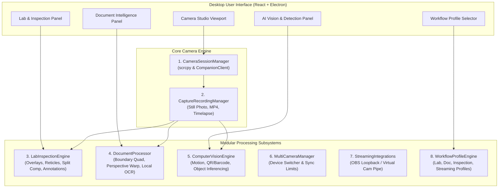

# ADR-003: Modular Multipurpose Camera and AI Platform Architecture Proposal

## Status
Accepted / Implemented (Phase 7 Baseline)

## Context & Readiness Assessment

AndroScrn has established verified milestones for:
- Desktop Android Device Workbench (USB & Wi-Fi device enumeration, battery telemetry, logcat streaming, raw binary framebuffers).
- Low-latency screen mirroring and Camera Studio Direct3D11 streaming (scrcpy 5.0.1 engine).
- Standalone supervised Model Context Protocol (MCP) stdio server with Human-in-the-Loop 6-digit PIN pairing, Named Pipe IPC, command tier boundaries, and emergency kill switch.
- Portable Windows zero-dependency distribution (`androscrn.exe` launcher, PowerShell environment PATH manager, standalone scrcpy/ADB runtime).
- Optional lightweight Android Camera Companion project (`android/companion` in Kotlin + Jetpack CameraX) with localhost USB loopback port forwarding (`127.0.0.1:8080`), cryptographic challenge pairing, in-app MJPEG streaming viewport, full-resolution still photo capture, lens flipping, smooth digital zoom, and anti-covert recording watermarks.
- Test suite baseline: **505 automated tests passing 100% green** (393 unit tests, 39 integration tests, 73 Playwright end-to-end UI tests).

### Blockers and Stability Findings
1. **Hardware-Accelerated scrcpy Stream vs. In-App Direct Manipulation:**
   - The native scrcpy Camera Studio renders into a high-performance Direct3D11 external window. While ideal for ultra-low latency preview (30–120 FPS), host-level pixel inspection and image annotation cannot be drawn directly inside that external GPU window.
   - **Resolution:** The Companion in-app viewport (`#companion-live-preview`) and the raw captured frame buffers (`Captures/`) render directly in the Electron/React DOM, providing an ideal substrate for non-destructive overlays, side-by-side comparison, and computer vision processing.
2. **Measurement Calibration Truth:**
   - Without an imaged physical optical target of known real-world dimensions (e.g., checkerboard or millimetric calibration ruler) and lens distortion intrinsics correction ($f_x, f_y, c_x, c_y, k_1, k_2$), pixel distances on phone cameras **cannot be claimed as calibrated millimeters**.
   - **Resolution:** All inspection tools strictly report pixel coordinates ($X, Y$), aspect ratios, and relative pixel percentages. Measurement calibration is explicitly classified as uncalibrated relative units until an optical calibration phase is executed.
3. **Privacy and Local Processing:**
   - Computer vision and document processing must operate 100% locally on host CPU/GPU without cloud data transmission unless the user explicitly configures an external provider.

---

## Modular Feature Architecture

To avoid monolithic code bloat and unmanageable dependencies, Phase 7 partitions capabilities into eight decoupled, independently testable modules:

### Module Responsibilities

1. **`CameraSessionManager` (`modules/camera_manager` & `modules/companion_client`):**
   - Manages connection lifecycle across scrcpy Direct3D11 and Android Companion APK.
   - Handles USB port-forwarding and reconnect backoff.
2. **`CaptureRecordingManager` (`modules/capture_manager`):**
   - Orchestrates still snapshot capture, MP4 continuous recording, and scheduled timelapse frame capture.
   - Guarantees capture metadata preservation (timestamp, sensor ID, lens facing, zoom, ISO/exposure).
3. **`LabInspectionEngine` (`modules/lab_inspection` - Initial Feature):**
   - Renders non-destructive SVG/canvas overlays: Rule of Thirds (3x3), Fine Grid (10x10), Precision Optical Crosshair, and Center Reticle.
   - Dual-pane side-by-side comparison with loaded reference golden sample.
   - Timestamped capture manifests and non-destructive image annotation.
   - Permissive export: raw capture files remain uncorrupted; annotated copies are only exported on explicit user command.
4. **`DocumentProcessor` (`modules/document_processor` - Staged Phase 7.2):**
   - Convex polygon boundary detection, 4-corner perspective rectification (homography warp), contrast enhancement, and local Tesseract OCR with confidence scoring.
5. **`ComputerVisionEngine` (`modules/vision_engine` - Staged Phase 7.3):**
   - Provider-independent visual detection interface.
   - Lightweight local frame difference motion detection and barcode/QR decoder.
   - Model inference adapter (supports local ONNX Runtime or optional remote endpoint with privacy disclosure).
6. **`MultiCameraManager` (`modules/multicam_manager` - Staged Phase 7.4):**
   - Serial-scoped switching between multiple USB/Wi-Fi connected devices.
   - Explicit documentation of independent clock drift and frame synchronization limits.
7. **`StreamingIntegrations` (`modules/streaming_integrations` - Staged Phase 7.4):**
   - OBS Studio integration via DirectShow virtual webcam or named loopback pipe.
8. **`WorkflowProfileEngine` (`modules/workflow_profiles` - Staged Phase 7.5):**
   - Preset configurations: Lab Capture, Document Scan, Inspection Session, Timelapse, Streaming Setup.
   - MCP automation integration with human approval gates and audit logging.

---

## Initial Feature Selection: Lab & Inspection Tools Suite

### Selection Rationale
- **Immediate High Utility:** Engineers, technicians, and QA testers actively require visual alignment grids, side-by-side sample comparison, and timestamped timelapses when examining hardware, circuit boards, or test benches.
- **Zero Heavy Native Dependencies:** Implemented with zero bloated external dependencies or multi-gigabyte neural network models.
- **Strict Non-Destructive Integrity:** Respects raw sensor fidelity; overlays exist purely in the display pipeline and are burnt into exports only when explicitly chosen.

---

## Staged Implementation Roadmap

| Milestone | Subsystem | Target Features | Quality Gates |
| :--- | :--- | :--- | :--- |
| **Phase 7.1 (Current)** | **Lab & Inspection Tools** | Alignment grids (3x3, 10x10), crosshairs, reticles, side-by-side reference comparison, timelapse scheduler, metadata export | Unit tests + Playwright UI verification + zero impact on raw captures |
| **Phase 7.2** | **Document Intelligence** | Document edge detection, perspective homography rectification, local OCR with uncertainty score, searchable PDF | Test with warped physical documents; zero cloud telemetry |
| **Phase 7.3** | **Computer Vision & AI** | Motion detection differential engine, QR/barcode decoder, ONNX inference adapter | Latency benchmark (<30ms on CPU), memory bound (<150MB) |
| **Phase 7.4** | **Multi-Camera & Streaming** | Multi-phone switcher, OBS loopback pipe, multi-stream recording | Documented synchronization limits; no dropped frames |
| **Phase 7.5** | **Workflow Automation** | 5 workflow profiles, MCP tools for lab capture, destructive action confirmation | Tier 2/3 HITL authorization and audit verification |
