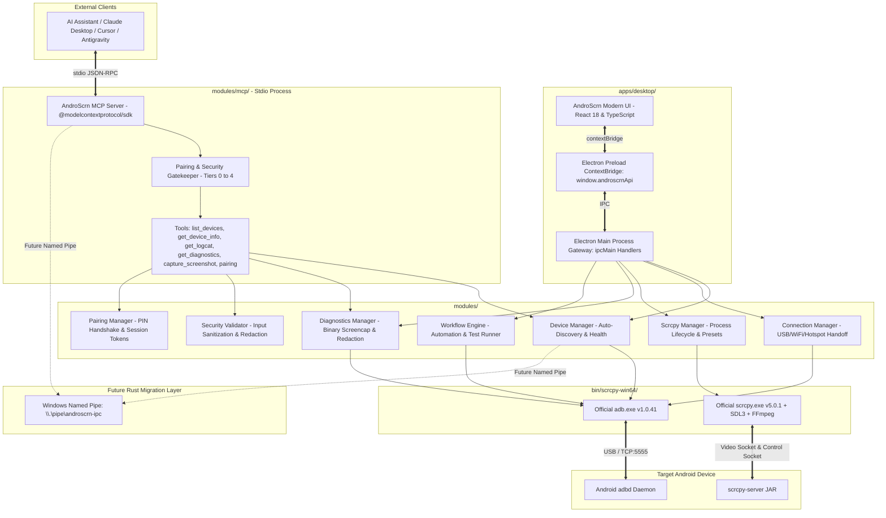

# AndroScrn System Architecture

**Product:** AndroScrn — Next-Generation Android Control & Automation Platform  
**Target OS:** Windows 10 / Windows 11 (x64)  
**Author:** AndroScrn Core Architecture Team  
**Date:** 2026-10-16  
**Related Decision Records:** [ADR-001: Architecture Reconciliation, Standalone MCP Server & Security Model](adr/001-architecture-reconciliation-and-mcp.md)

---

## 1. System Vision & Design Principles

AndroScrn is an independent Windows-first desktop application engineered to provide frictionless, ultra-reliable Android device control, high-framerate wireless mirroring, intelligent workflow automation, device diagnostics, and local AI assistance via the Model Context Protocol (MCP).

### Key Architectural Pillars:
1. **Local-First & Zero-Cloud Dependency:** Device streaming, input simulation, ADB handshakes, OCR, diagnostics, and AI features run 100% locally on the host machine.
2. **Modular Engine Integration:** Leverages Genymobile's low-latency C/SDL3/FFmpeg video pipeline and Google's official Android Debug Bridge (ADB) via decoupled supervisory adapters.
3. **Enterprise Process Supervision:** Child processes are launched via isolated argument vectors (no raw shell interpolation), tracked via OS process identifiers, continuously monitored for exit codes, and recovered with defensive backoff.
4. **Decoupled Standalone MCP Server:** Exposes a standard Model Context Protocol server over standard I/O (`stdio`), enabling external AI assistants (Claude Desktop, Cursor, Antigravity) to query devices, stream redacted logcat, and capture verified screenshots without requiring the GUI to be running.
5. **Pairing-First Security Model:** Strict authorization boundary separating read-only telemetry (Tiers 0–2) from mutating device actions (Tiers 3–4), guarded by a 6-digit numeric PIN handshake, token validation, brute-force rate limits, and an Emergency Kill Switch.

---

## 2. Component Hierarchy Diagram

---

## 3. Subsystem Breakdown

### 3.1 Device Manager (`modules/device_manager`)
* **Responsibility:** Periodically polls ADB devices (`adb devices -l`), parses device descriptors (Serial, Model Name, Product, Device State).
* **States Handled:** `unauthorized`, `offline`, `connecting`, `device` (authorized & ready).
* **Device Identity:** Enriches hardware serials with user-defined friendly aliases, persistent preferences, and battery/power metrics.

### 3.2 Connection Manager (`modules/connection_manager`)
* **Responsibility:** Manages all transport transitions:
  * **USB Mode:** Direct wired connection.
  * **1-Click Wireless Handoff:** Extracts device WLAN IP, enables TCP/IP port 5555 over USB, establishes network socket, signals user when cable is safe to detach.
  * **Hotspot Auto-Discovery:** Detects active default gateway IP when laptop joins Android hotspot (e.g. `192.168.43.1`), connecting without typing IP addresses.
  * **Android 11+ Pair Wizard:** Guides 6-digit PIN entry with pairing port verification.
  * **Resilient Reconnector:** Re-polls and attempts bounded reconnection if network packets drop.

### 3.3 Scrcpy Manager (`modules/scrcpy_manager`)
* **Responsibility:** Spawns and supervises `scrcpy.exe`.
* **Parameter Compositor:** Formats CLI arguments safely:
  * Bitrate presets (2 Mbps to 20 Mbps)
  * Resolution limits (720p, 1080p, 1440p, native)
  * Framerate caps (30, 60, 120 FPS)
  * Video Codec selection (`h264`, `h265`, `av1`)
  * Feature toggles: Stay awake (`-w`), Turn screen off (`-S`), Fullscreen (`-f`), Show touches (`-t`).
* **Session Recording:** Flags `--record=<path>` with automated timestamping in `Captures/` and zero CPU re-encoding overhead.

### 3.4 Diagnostics Manager (`modules/diagnostics`)
* **Responsibility:** System health introspection and device telemetry:
  * **Binary Screencap:** Streams raw binary frame buffer via `adb exec-out screencap -p` and verifies PNG magic bytes (`89 50 4E 47`) directly from hardware.
  * **Logcat Streamer:** Extracts bounded recent logcat lines formatted via threadtime with priority level parsing (`V`, `D`, `I`, `W`, `E`, `F`).
  * **Sanitized Bundle Generation:** Combines host OS specifications, bundled ADB/scrcpy versions, device properties, and recent logs with automatic regex credential redaction.

### 3.5 Security Validator (`modules/security`)
* **Responsibility:** Defensive gatekeeper for all external and internal inputs:
  * Serial format validation (alphanumeric, dot, colon, hyphen; rejects semicolons, pipes, and operators).
  * IPv4 and port boundary validation (1–65535).
  * Safe path resolution to defend against directory traversal attacks.
  * Credential redaction engine (replaces email addresses, bearer tokens, API keys, and 6-digit PINs with sanitized placeholders).

### 3.6 Model Context Protocol (MCP) Server (`modules/mcp`)
* **Responsibility:** Standardized JSON-RPC interface for external AI assistants:
  * Built on official `@modelcontextprotocol/sdk`.
  * Standalone executable CLI (`bin/androscrn-mcp.bat` / `modules/mcp/cli.ts`).
  * Decoupled from desktop GUI; runs headless in CI or local developer workflows.
  * Exposes read-only telemetry tools (`list_devices`, `get_device_info`, `get_logcat`, `get_diagnostics`, `capture_screenshot`).
  * Exposes pairing handshake tools (`request_pairing`, `pair_session`, `get_pairing_status`).

---

## 4. Security Architecture

1. **Strict Argument-Vector Invocation:** Never pass commands to `cmd.exe /c` or shell strings. All parameters pass as immutable arrays to `child_process.spawn`.
2. **Host-Bound Networking:** ADB server binds to `127.0.0.1:5037`. Remote ports are never exposed to public internet interfaces.
3. **Multi-Tier Permission Matrix (Tiers 0–4):**
   * **Tier 0 (`read:telemetry`):** Allowed unconditionally (sanitized metadata).
   * **Tier 1 (`read:logs`):** Allowed with automatic token and email redaction.
   * **Tier 2 (`read:screen`):** Allowed with PNG signature validation.
   * **Tier 3 (`write:input`):** Requires active 6-digit PIN paired session token.
   * **Tier 4 (`write:admin`):** Requires interactive human GUI confirmation.
4. **Brute-Force Rate Limiting:** Pairing PIN invalidates after 3 incorrect attempts.
5. **Emergency Kill Switch:** Instant revocation of all active session tokens via `PairingManager.revokeAllSessions()`.
6. **Path Traversal Defense:** Capture file paths and logs resolve strictly within canonicalized destination folders via `SecurityValidator.resolveSafePath`.
