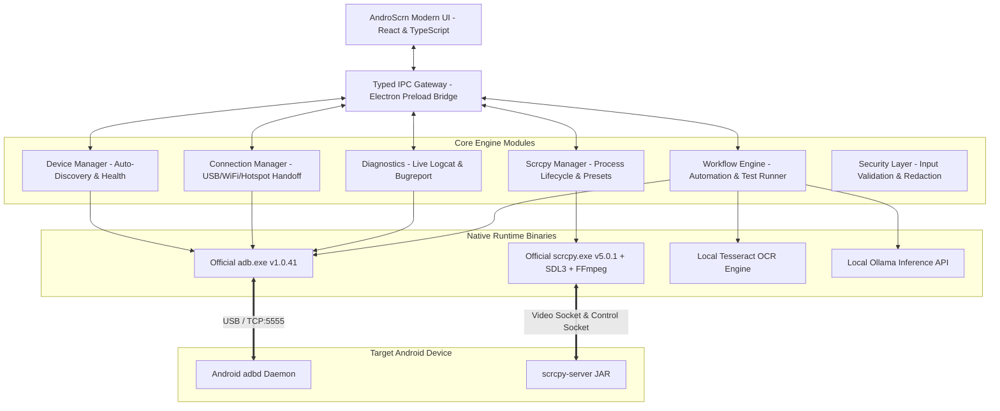

# AndroScrn System Architecture

**Product:** AndroScrn — Next-Generation Android Control & Automation Platform  
**Target OS:** Windows 10 / Windows 11 (x64)  
**Author:** AndroScrn Core Architecture Team  
**Date:** 2026-10-16  

---

## 1. System Vision & Design Principles

AndroScrn is an independent Windows-first desktop application engineered to provide frictionless, ultra-reliable Android device control, high-framerate wireless mirroring, intelligent workflow automation, device diagnostics, and on-device privacy-preserving AI assistance.

### Key Architectural Pillars:
1. **Local-First & Zero-Cloud Dependency:** Device streaming, input simulation, ADB handshakes, OCR, and AI features run 100% locally on the host machine.
2. **Modular Engine Integration:** Leverages Genymobile's low-latency C/SDL3/FFmpeg video pipeline and Google's official Android Debug Bridge (ADB) via decoupled supervisory adapters.
3. **Enterprise Process Supervision:** Child processes are launched via isolated argument vectors (no raw shell interpolation), tracked via OS process identifiers, continuously monitored for exit codes, and recovered with exponential backoff.
4. **Rich, Modern UI/UX:** Built with a dark glassmorphic design system, tactile micro-animations, clear empty/loading/error states, and intuitive one-click workflows for both non-technical users and QA engineers.

---

## 2. Component Hierarchy Diagram

---

## 3. Subsystem Breakdown

### 3.1 Device Manager (`modules/device_manager`)
* **Responsibility:** Periodically polls ADB devices (`adb devices -l`), parses device descriptors (Serial, Model Name, Product, Device State).
* **States Handled:** `unauthorized`, `offline`, `connecting`, `device` (authorized & ready).
* **Device Identity:** Enriches hardware serials with user-defined friendly aliases, persistent preferences, and battery/power metrics.

### 3.2 Connection Manager (`modules/connection_manager`)
* **Responsibility:** Manages all transport transitions:
  * **USB Mode:** Direct wired connection.
  * **1-Click Wireless Handoff:** Extracts device WLAN IP, enables TCP/IP port 5555 over USB, establishes network socket, signals user when cable is safe to detach.
  * **Hotspot Auto-Discovery:** Detects active default gateway IP when laptop joins Android hotspot (e.g. `192.168.43.1`), connecting without typing IP addresses.
  * **Android 11+ Pair Wizard:** Guides 6-digit PIN entry with pairing port verification.
  * **Resilient Reconnector:** Re-polls and attempts bounded reconnection if network packets drop.

### 3.3 Scrcpy Manager (`modules/scrcpy_manager`)
* **Responsibility:** Spawns and supervises `scrcpy.exe`.
* **Parameter Compositor:** Formats CLI arguments safely:
  * Bitrate presets (2 Mbps to 20 Mbps)
  * Resolution limits (720p, 1080p, 1440p, native)
  * Framerate caps (30, 60, 120 FPS)
  * Video Codec selection (`h264`, `h265`, `av1`)
  * Feature toggles: Stay awake (`-w`), Turn screen off (`-S`), Fullscreen (`-f`), Show touches (`-t`).
* **Session Recording:** Flags `--record=<path>` with automated timestamping in `Captures/` and zero CPU re-encoding overhead.

### 3.4 Workflow & Automation Engine (`modules/workflow_engine`)
* **Responsibility:** Step-by-step test execution:
  * `tap(x, y)`: Injects touchscreen coordinate event.
  * `swipe(x1, y1, x2, y2, duration)`: Injects gestures.
  * `keyevent(code)`: Sends Android hardware keys (Home, Back, Enter).
  * `input_text(str)`: Types text safely into focused inputs.
  * `wait(ms)`: Delay timers.
  * `screenshot(label)`: Captures screen frame for visual record.
  * `assert_text(str)`: Leverages local Tesseract OCR to assert expected text appears on screen.

### 3.5 Local Intelligence Layer (`modules/intelligence`)
* **Tesseract OCR:** In-process screen inspection to locate UI elements by visual text.
* **Ollama Client:** Offline LLM interaction (e.g. explaining crash logs, diagnosing ANRs, auto-generating test sequences) via localhost REST requests.

---

## 4. Security Architecture

1. **Strict Argument-Vector Invocation:** Never pass commands to `cmd.exe /c` or shell strings. All parameters pass as immutable arrays to `child_process.spawn`.
2. **Host-Bound Networking:** ADB server binds to `127.0.0.1:5037`. Remote ports are never exposed to public internet interfaces.
3. **Sanitized Diagnostics:** Diagnostic exports redact sensitive tokens (passwords, serial numbers, personal accounts) prior to zip generation.
4. **User-Approved Actions:** APK installation and shell actions require explicit user confirmation.
