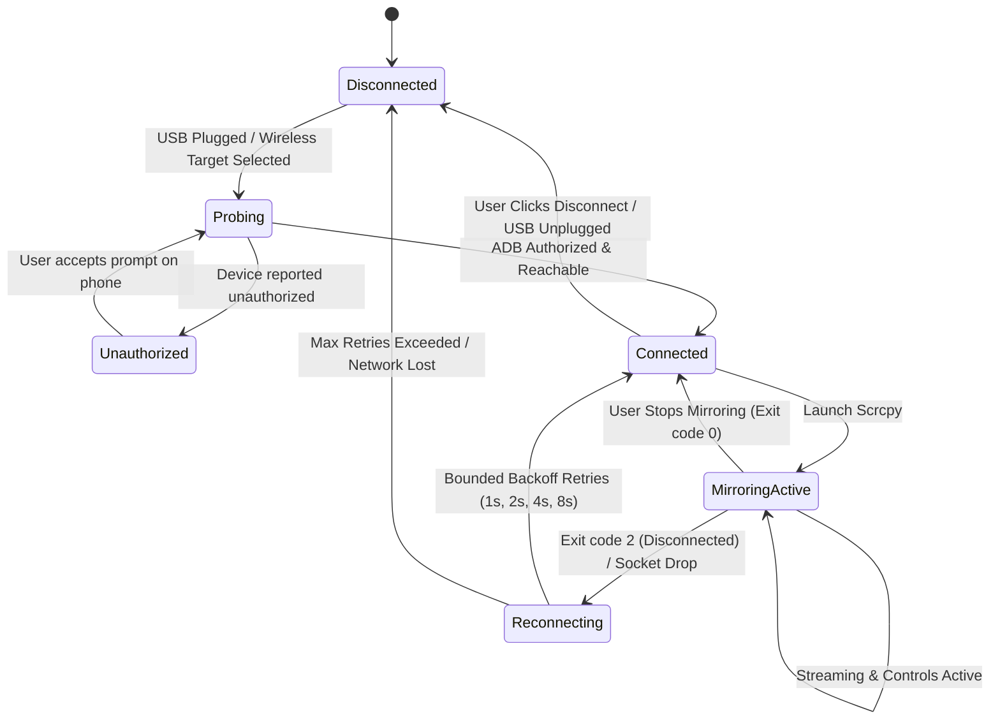

# Reference Application & Protocol Analysis

**Document:** `docs/reference-analysis.md`  
**Target:** AndroScrn Architectural Blueprint  
**Date:** 2026-10-16  

---

## 1. Reference Product Breakdown

The reference concept ("Android Control Center") was conceived as a lightweight, portable Windows utility delivering frictionless USB and wireless screen mirroring and input control for Android devices without requiring a companion APK or third-party cloud service.

### Functional Matrix & Protocol Analysis

| Capability | Underlying Mechanism | Technical Workflow | Verified Feasibility |
| :--- | :--- | :--- | :--- |
| **USB Discovery** | `adb devices -l` | ADB client queries `adbd` over USB descriptor endpoints; outputs serial, product, model, device ID. | **Verified** |
| **USB Debug Authorization**| RSA 2048/4096-bit key exchange | Computer presents `~/.android/adbkey.pub`; Android OS prompts user for fingerprint authorization. If pending, reports `unauthorized`. | **Verified** |
| **Wireless Debugging (Android 11+)** | `adb pair <ip>:<port> <pin>` + `adb connect <ip>:<connect_port>` | Uses mDNS/TLS pairing service. Ephemeral pairing port with 6-digit PIN; permanent connect port. | **Verified** |
| **USB-to-TCP/IP Handoff (Classic)** | `adb -s <serial> tcpip 5555` followed by `adb connect <ip>:5555` | Commands device `adbd` daemon to restart listening on TCP port 5555. Cable can then be unplugged. | **Verified** |
| **Phone-Hotspot Mode** | Dynamic Gateway Discovery | When laptop connects to Android hotspot, the phone's IP is typically the Default Gateway (`192.168.43.1` or DHCP lease gateway). | **Verified** |
| **Screen Mirroring & Control** | `scrcpy` protocol + `app_process` server | Pushes `scrcpy-server` jar to `/data/local/tmp/`, executes via `app_process`, establishes video and control sockets via ADB port forwarding/reverse tunneling. | **Verified** |
| **Keyboard/Mouse Input** | Android `InputManager` / HID injection | Scrcpy injects `MotionEvent` / `KeyEvent` directly into Android `InputManager` or simulates USB HID via AOA/UHID. | **Verified** |
| **Clipboard Sync** | Android Clipboard Service + ADB fallback | Bi-directional text synchronization via scrcpy control channel and keycode injection (`MOD+v` / `MOD+c`). | **Verified** |
| **Audio Forwarding** | Android 11+ AudioPlaybackCapture API | Scrcpy creates virtual audio record session on Android 11+ and streams OPUS/AAC/RAW PCM. | **Verified** |
| **Recording** | Scrcpy muxer (`--record=file.mp4`) | Client-side container muxing without re-encoding overhead (direct pass-through of H.264/H.265 stream). | **Verified** |
| **Process Supervision** | OS Process Table / Job Objects | Parent process maintains handle, monitors exit code, parses stderr/stdout asynchronously, prevents orphaned subprocesses. | **Verified** |

---

## 2. Deep Dive: Wireless Connectivity Topologies

### Scenario A: Same Local Wi-Fi Network (Standard Office / Home)
1. Device and PC are on the same subnet (e.g. `192.168.1.x`).
2. PC queries phone IP via USB (`adb shell ip -f inet addr show wlan0` or `adb shell getprop dhcp.wlan0.ipaddress`).
3. PC executes `adb tcpip 5555`.
4. PC connects: `adb connect 192.168.1.x:5555`.
5. USB cable can be safely disconnected; mirroring starts over Wi-Fi.

### Scenario B: Phone as Wi-Fi Hotspot (Field / Mobile Mode)
1. The user turns on Android Personal Hotspot; PC connects to that Wi-Fi SSID.
2. In hotspot mode, the phone's Wi-Fi interface is `wlan1` or `ap0` (or `softap0`), and the phone acts as the default gateway (typically `192.168.43.1`, `192.168.50.1`, etc.).
3. The PC desktop app inspects the active network adapter's Default Gateway (`Get-NetRoute` or Node `os.networkInterfaces()`).
4. If paired previously or initialized via USB, AndroScrn connects directly to the gateway IP: `adb connect <gateway_ip>:5555`.
5. Fast, zero-configuration wireless link even when no router or external internet is present.

### Scenario C: Android 11+ Wi-Fi Pairing (Zero-Cable Setup)
1. User opens *Developer Options -> Wireless Debugging -> Pair device with pairing code*.
2. Phone displays IP, pairing port (e.g. `<phone-ip>:41235`), and a 6-digit PIN.
3. User enters PIN into AndroScrn.
4. AndroScrn executes `adb pair <phone-ip>:41235 <PIN>`.
5. On success, user connects to the separate connect port shown on the phone screen: `adb connect <phone-ip>:38291`.

---

## 3. Disconnection & Reconnection State Machine

---

## 4. Reverse Engineering Best Practices Learned from REA

From reviewing the REA repository (`morluto/rea`), AndroScrn adopts several key engineering patterns:
1. **Isolated Argument Vectors:** Never construct raw shell command strings like `cmd /c "adb connect " + ip`. Always pass arguments as sanitized discrete arrays (`['connect', `${ip}:${port}`]`) to prevent command injection and parsing errors.
2. **Deterministic Probing:** Check client binary capabilities (`adb version`, `scrcpy --version`) before starting long-running server operations.
3. **Structured Event Stream:** Parse logcat and status logs line-by-line using regular expressions rather than buffering entire streams in memory.
4. **State Segregation:** Keep connection state distinct from UI presentation state so network drops cleanly surface in the UI with actionable recovery suggestions.
